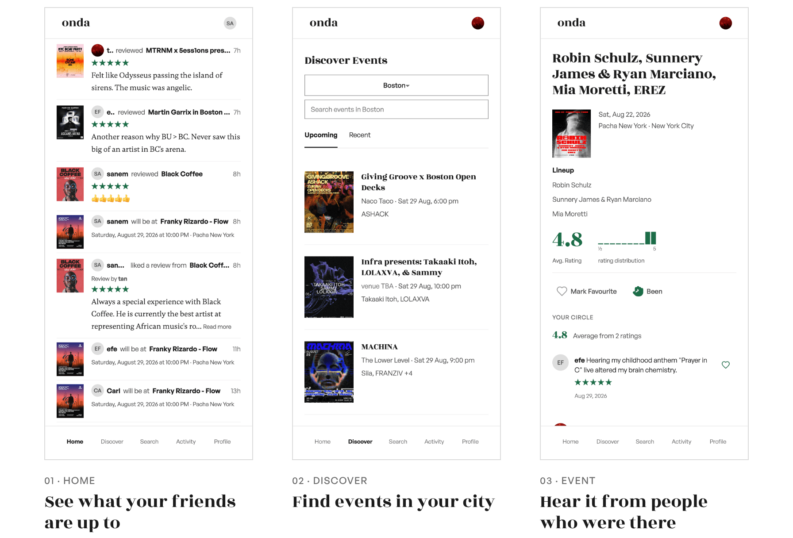
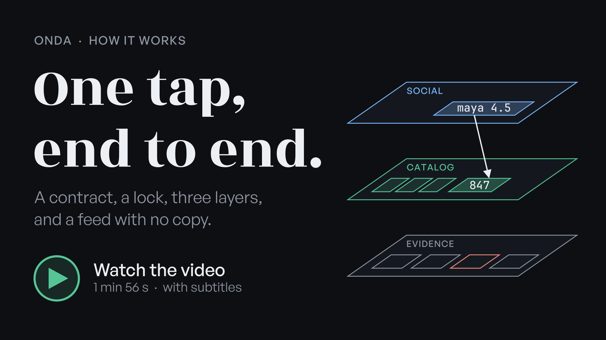

  

  <b>A social diary for live music.</b> 
  Find events. Record your nights. Follow taste that you trust.

  <a href="https://ondaapp.io/"><b>Live site</b></a> ·
  <a href="docs/PRODUCT.md">Product</a> ·
  <a href="docs/ARCHITECTURE.md">How it works</a> ·
  <a href="docs/DECISIONS.md">Decisions</a> ·
  <a href="docs/API.md">API</a> ·
  <a href="docs/DATABASE.md">Database</a> ·
  <a href="docs/README.md">All pages</a>

  
  

  <picture>
    <source media="(prefers-color-scheme: dark)" srcset="docs/assets/hero-dark.png">
    
  </picture>

## What Onda is

Onda is a web app for people who go to concerts and club nights.
A person finds an event, goes, gives it a rating, and writes a review. Friends see that activity in a feed.

Onda is live at [ondaapp.io](https://ondaapp.io/) with events in New York City and Boston.
I build it in my free time, and a small group of friends uses it.
The [product page](docs/PRODUCT.md) explains the product and the reason for each rule, with no technical words.

## See it in 90 seconds

  

The video follows one rating from the tap of one person to the feed of a friend.
I made it with Claude Code: Manim draws the animation, and ElevenLabs gives the voice.
The scenes are code in [`docs/video/`](docs/video/README.md).

## The engineering problem

Live music has no complete catalog with authority.
Onda reads event listings from a website that it does not control.
Those listings change, disappear, and arrive with errors.
The design obeys three rules:

1. A bad listing must not damage the catalog.
2. A missing listing must not delete the history of a person.
3. A request of a person must not wait for the source.

## How it works

- **Nightly path.** A schedule starts a run. The client fetches each page inside fixed limits. Onda stores each response before it parses the response. Then each valid listing goes into the catalog in one transaction.
- **Request path.** The React app calls a JSON API on the same origin. A view validates the request. A service function makes the change in one transaction. The constraints of MySQL are the last guard.
- **One database, three zones.** Evidence, catalog and social data. Keys point one way, from social data to the catalog. A source ID stops at an identity map.

[Follow one rating through the system](docs/ARCHITECTURE.md)

## The principles in this code

| Principle | Where Onda uses it | What it prevents |
|---|---|---|
| **Atomicity** | One listing is one transaction: venue, artists, event, lineup and IDs | Half of an event in the catalog |
| **Idempotency** | A replay of a listing updates the same rows. A second `PUT` returns `200` | Duplicates after a retry or a crash |
| **A durable log first** | Onda stores each response before it parses the response | A conclusion that nobody can repeat |
| **Negative inference from complete data only** | An absent event is a miss only in a complete snapshot. Three misses hide it. Nothing deletes it | A network error that removes real events |
| **Stable identity** | Four identity maps change source IDs into Onda IDs | User data that breaks when the source changes |
| **Invariants in the schema** | 17 named check constraints, composite primary keys, foreign keys with `RESTRICT` | A rule that only one code path obeys |
| **Isolation** | A row lock makes each "read, then write" sequence safe at `READ COMMITTED` | Two requests that pass the same limit |
| **Derive, do not copy** | Home is one `UNION ALL` on the source rows. There is no feed table | Old copies, and jobs that repair them |
| **A total order for pages** | The cursor is `(time, type, key)` | A row that shows two times, or not at all |
| **Bounded failure** | A timeout, 3 attempts, backoff with jitter, a request budget, an advisory lock | A slow source that stops the system |

Each row is a decision with options and a cost. [Read the 16 decisions](docs/DECISIONS.md)

## Proof

| Claim | Where to look |
|---|---|
| 265 backend tests pass on MySQL | The [CI runs](https://github.com/tanbaydar/onda/actions/workflows/ci.yml), or `python manage.py test` |
| 158 frontend tests pass | `npm test` |
| Home answers in 88 ms at p95 with 100,000 seeded rows. Page 50 is not slower than page 1 | The [benchmark record](benchmarks/home-feed/results-2026-11-27.yaml) |
| The live API answers on HTTPS with six security headers | `curl -sI https://ondaapp.io/api/cities/` |
| The nightly path operates in production: 329 upcoming events in New York City on 2026-11-27 | `curl "https://ondaapp.io/api/events/?when=upcoming&city_id=1&page_size=1"` |
| Each deploy uses the tested commit, after a backup | The [workflow](.github/workflows/ci.yml) and the [deploy script](infrastructure/scripts/deploy.sh) |
| These pages obey a writing standard | `python3 docs/tools/check_docs.py` |

## Documentation

| You are | Read |
|---|---|
| All readers | [Product](docs/PRODUCT.md): what Onda is, with no technical words |
| An engineer who wants to understand | [How it works](docs/ARCHITECTURE.md), then [Decisions](docs/DECISIONS.md) |
| An engineer who wants depth | [Ingestion](docs/INGESTION.md) and [Home feed](docs/HOME_FEED.md) |
| An engineer who writes code against it | [API reference](docs/API.md) and [Database reference](docs/DATABASE.md) |
| An engineer who runs or operates it | [Development](docs/DEVELOPMENT.md) and [Operations](infrastructure/README.md) |

The pages use ASD-STE100 Simplified Technical English, the standard for aircraft maintenance manuals.
A sentence is short, a word has one meaning, and the voice is active.
A script checks the rules in CI. See the [writing standard](docs/STYLE.md).

## Tools

Python 3.12 · Django 6 · MySQL 8.4 · React 19 · Vite 8 · Docker Compose · Caddy · GitHub Actions

I selected tools that I knew well. Thus the risk was in the problem and not in the tools.
[Decision 16](docs/DECISIONS.md#16-tools-that-i-know) gives the reason for each tool.

## Limits

- **One host.** The host is a single point of failure, and the backup is daily.
- **One source.** If the source stops, the catalog gets no new events. Reads and writes continue.
- **A read that increases.** The first page of Home reads all visible rows of the followees. [Home feed](docs/HOME_FEED.md#the-cost-and-the-limit) gives the measurement.
- **Not a public API.** The API serves this app only.

## About

I am Tan Baydar. I designed and built Onda, and I operate it.

Onda has no connection with Resident Advisor. [Ingestion](docs/INGESTION.md#the-source-and-permission) describes the source.

<!-- docs-check: off -->
Copyright © 2026 Tan Baydar. All rights reserved.

This repository is published for inspection. No license is granted to use, copy, modify, distribute, sublicense, or create derivative works from its contents beyond the rights GitHub requires to provide its public-repository features.
<!-- docs-check: on -->
