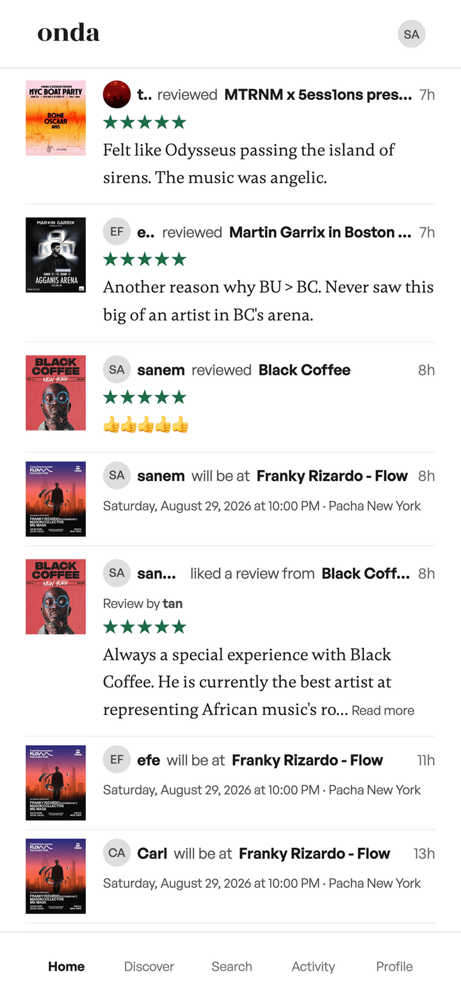
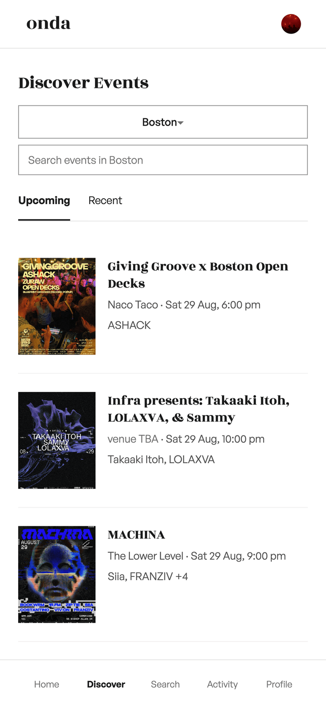
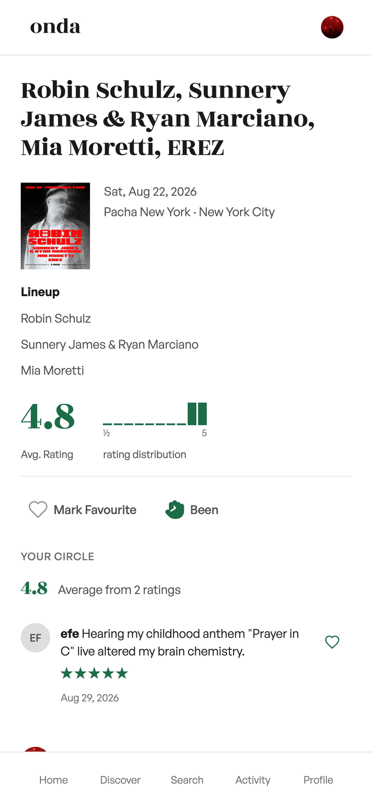
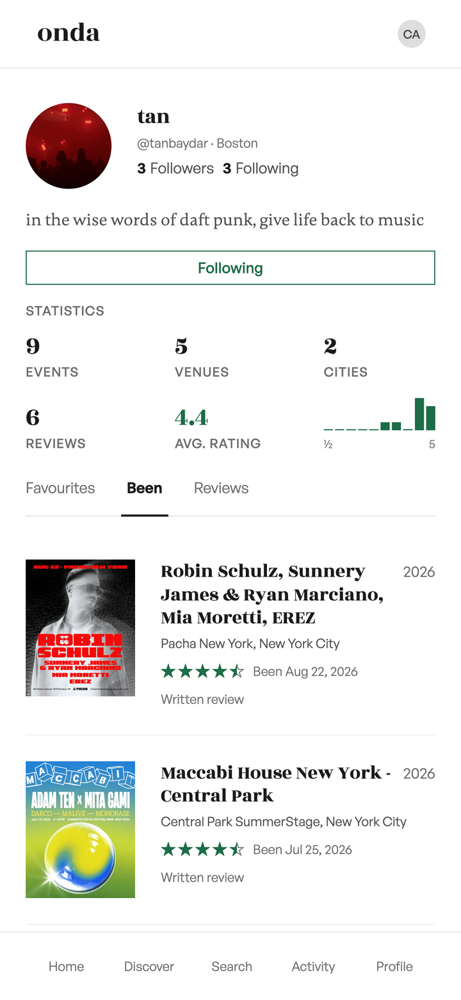
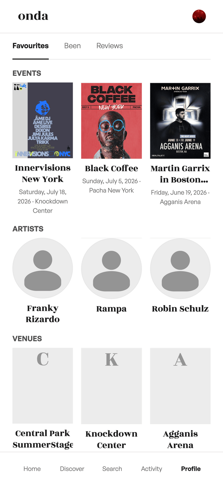

[Onda](../README.md) / [Documentation](README.md) / Product

# What Onda is

> **For** all readers. This page has no technical words. **Read time** 4 minutes.

Onda is a social diary for live music.
You find an event, you go, and you keep the night: a rating, some words, and the friends who were there.

**[Open Onda](https://ondaapp.io/)**. You can look at the events of New York City and Boston with no account.

## Why I built it

Music is the deepest interest of my life. I played the piano for six years, and then I tried to become a professional athlete.
The piano did not become my job, and sport did not. The music stayed. For some years now, it is house music.

After a good night, I wanted to record it and to tell people who care.
Instagram was not the place. Most of the people who follow me there do not care about a lineup in Brooklyn.

I also saw a change. People leave the large social networks for small ones about one subject.
Beli is for restaurants. Letterboxd is for films. Goodreads is for books.

In each one, the people have taste and intention for that subject.
Live music had some apps of this type, but not one became common.

So I found a gap in my own life, and I wanted to know if good engineering can close it.
Onda is my answer. I build it in my free time, and a small group of friends uses it.

## One night, six steps

## The screens

<table>
  <tr>
    <td align="center" valign="top" colspan="2" width="33.33%">
      
       <b>Home</b>
       See what your friends are up to
    </td>
    <td align="center" valign="top" colspan="2" width="33.33%">
      
       <b>Discover</b>
       Find events in your city
    </td>
    <td align="center" valign="top" colspan="2" width="33.33%">
      
       <b>Event</b>
       Hear it from people who were there
    </td>
  </tr>
  <tr>
    <td align="center" valign="top" colspan="3" width="50%">
      
       <b>Profile</b>
       Who you are, based on what you do
    </td>
    <td align="center" valign="top" colspan="3" width="50%">
      
       <b>Favourites</b>
       Let your taste speak
    </td>
  </tr>
</table>

| Screen | What you do there |
|---|---|
| Home | Read the ratings, the reviews and the plans of the people that you follow, newest first |
| Discover | Select a city. Look at the events that come next and at the events of the last days |
| Event | See the lineup, the average rating and the reviews. The opinions of your circle come first |
| Profile | Keep your diary: each night, your rating, your review, and your numbers |
| Favourites | Show three events, three artists and three venues that tell who you are |

There are two more screens. Search finds events, artists, venues and people. Activity shows who liked your review and who follows you.

## The decisions, and the reason for each

Each rule in Onda is a decision about a person who uses it.

| Decision | Reason |
|---|---|
| **The diary opens when the event starts.** | You cannot give a rating to a night that did not occur. Thus each rating is about a real night |
| **A plan is not a rating.** | "Will Be There" is for the time before. "Been" is for the time after. A plan does not count as a judgment |
| **A plan stops at the end of the day of the event.** | An old plan must not look like news |
| **Ratings use half stars, from a half star to five.** | Ten steps are sufficient to divide a good night from a great night. People know the scale from film diaries |
| **A review must have a rating.** | The stars tell how much. The words tell why. A friend understands the stars in one second |
| **One rating is sufficient to show an average.** | At first, Onda showed an average only after three ratings. Small nights then had empty pages. But an underground night has the same value as a large night. Now the number of ratings shows next to the average, and you make the judgment |
| **You select three favorites of each type.** | A short list makes you select. Three events, three artists and three venues tell your taste in one look. A list with no limit tells nothing |
| **Home shows the people that you follow, in time order.** | No program selects for you, and there are no advertisements. You see the taste that you trust |
| **A private profile hides what you did. It does not hide who you know.** | Your diary, your plans and your favorites are for the followers that you approve. Your connections stay visible, so a person can see if they know you before they ask |
| **A private rating counts in the average, with no name.** | Your judgment helps all people. Your identity stays with you |
| **An event that disappears is hidden, not deleted.** | A listing can disappear by error. Your plans and your favorites stay, and they come back with the event |
| **Green has one job.** | Green shows a judgment: stars, likes and plans. Buttons and menus are black or gray. Thus your eye finds the opinions first |
| **No tickets, no timers, no pressure.** | Onda is a diary and not a shop |

The [design contract](../frontend/DESIGN_CONTRACT.md) has the full rules for type, color and space.

## Who can see what

| Your data | Public profile | Private profile |
|---|---|---|
| Name, photo, bio, home city, number of followers | All people | All people |
| The lists of your followers and of the people that you follow | All people | All people |
| Diary, ratings, reviews, plans, favorites, statistics | All people | Followers that you approve |
| Your rating in the average of an event | In the number, with no name | In the number, with no name |
| Your email address | Only you | Only you |

- A follow to a public profile starts immediately. A follow to a private profile is a request, and the owner accepts or declines it.
- If you change a private profile to public, Onda accepts all open requests at that moment.

## What Onda is not

- It is not a ticket shop. It does not sell or keep a place for you.
- It is not a list of all events in the world. It has two cities.
- It is not a business. It is a personal project, and it has no advertisements.

## Where the events come from

Each night, Onda reads the public event listings of [Resident Advisor](https://ra.co), a site for electronic music.
Onda has no connection with Resident Advisor.

## Status

| Item | Value |
|---|---|
| Address | [ondaapp.io](https://ondaapp.io/) |
| Cities | New York City and Boston |
| Events in the catalog on 2026-11-27 | 4,990, and 360 of them come next |
| People | A small group of friends |

**Next:** [how Onda works](ARCHITECTURE.md), for engineers.
