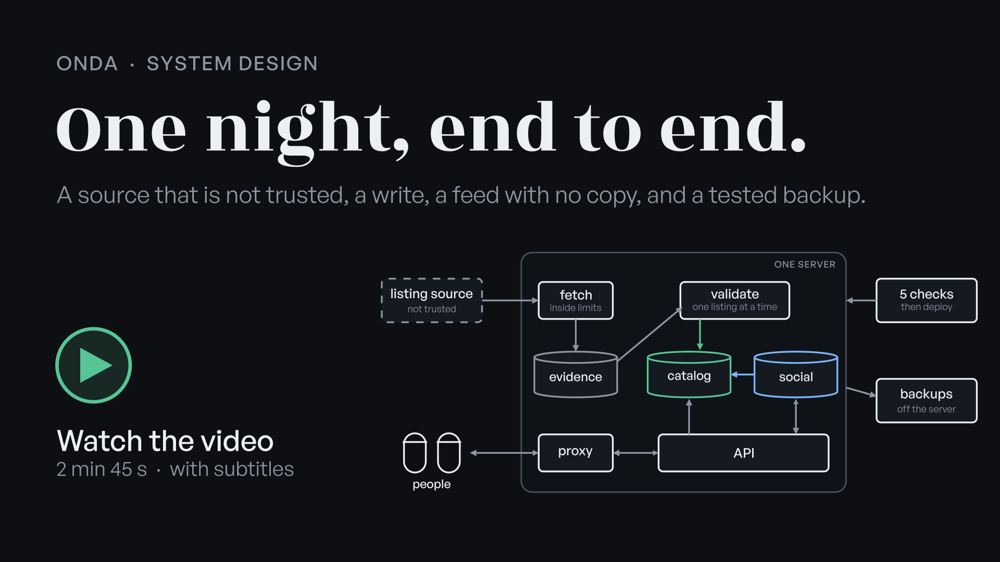

[Onda](../../README.md) / [Documentation](../README.md) / Video source

# The video: each scene is code

> **For** engineers who want to change the video, or make one for a different system. **Read time** 5 minutes.

[The video](../assets/video/onda-how-it-works.mp4) shows the design of the full system in the sequence of one night.
Its length is 2 minutes 45 seconds. No person moved clips on a timeline. Five steps make the file from one text.

<p align="center">
  <a href="../assets/video/onda-how-it-works.mp4"></a>
</p>

## In brief

- The video has six chapters. Each chapter shows the name of the page that has its facts.
- The narration is text with cue marks. A cue mark gives a name to the word that follows it.
- The voice service returns the time of each character. Thus each cue has a time.
- Each animation waits for its cue. If the voice changes, the picture follows it.
- A check runs the scene with no frames, and it finds each animation that starts late.
- I gave the brief. Claude Code wrote the script, the scenes and the tools.

## The chapters

| Start | Chapter | What you see | The facts |
|---|---|---|---|
| 0:00 | Start | The product, its author, and a map of the system | [Overview](../../README.md) |
| 0:13 | 1. The catalog | A trust boundary, a client with limits, stored responses, one transaction for each listing, and a replay | [Ingestion](../INGESTION.md) |
| 0:44 | 2. The request | A read that does not call the source, and one server with three containers | [Architecture](../ARCHITECTURE.md) |
| 0:56 | 3. The write | The three states of an entry, four guards, and two requests at the same time | [Architecture](../ARCHITECTURE.md#step-2-the-write-is-one-transaction) |
| 1:15 | 4. The feed | One query with five branches, a keyset cursor, a benchmark, and the limit of the design | [Home feed](../HOME_FEED.md) |
| 1:41 | 5. The missing listing | Complete and partial snapshots, the miss count, and an event that is hidden but not deleted | [Ingestion](../INGESTION.md#rule-5-a-miss-is-a-suspicion) |
| 1:59 | 6. Operations | Five checks, the deploy steps, the daily backup, the monthly restore test, and the limit of one server | [Operations](../../infrastructure/README.md) |
| 2:28 | End | Four rules, and the 16 decision records | [Decisions](../DECISIONS.md) |

## Who did what

| Part | Who | How |
|---|---|---|
| The brief: the audience, the story line, the style | I | A conversation with Claude Code |
| The script, the scenes, the tools, and the review of the frames | Claude Code | Python, [Manim](https://www.manim.community/) and `ffmpeg` |
| The voice | [ElevenLabs](https://elevenlabs.io/) | A voice from my account. The API returns the sound and the time of each character |
| The facts | The code of this repository | Each number on the screen is in a page of the table above |

## The pipeline

| Step | File | Input | Output |
|---|---|---|---|
| 1. Words | [`narration.py`](narration.py) | | The text of each line, with cue marks |
| 2. Voice | [`voice.py`](voice.py) | The words | `narration.m4a`, [`timings.json`](timings.json), and the subtitles as `.srt` and `.vtt` files |
| 3. Picture | [`scene.py`](scene.py) and [`kit.py`](kit.py) | The cue times | A picture of 1920 by 1080 at 60 frames for each second, with no sound |
| 4. Check | [`check_sync.py`](check_sync.py) | The scene and the cue times | A list of the late cues |
| 5. Join | [`build.py`](build.py) | The picture, the voice and the subtitle times | [`onda-how-it-works.mp4`](../assets/video/onda-how-it-works.mp4) |

## How the picture follows the voice

A line of the narration has a text for the voice and a text for the subtitle:

```python
("{w_two}Two taps at the same instant |{w_one}still make one row.",
 "Two taps at the same instant | still make one row."),
```

`voice.py` removes the marks and sends the text to the voice service.
The answer has the sound and the start time of each character.
The script writes the time of the word that follows each mark:

```json
"w_two": 71.561, "w_one": 73.237
```

The scene waits for a cue, and then it starts the animation:

```python
self.cue("w_one", -0.25)      # 0.25 s before the words "still make one row"
self.play(second.animate.move_to(row.get_left() + LEFT * 0.15 + DOWN * 0.1), run_time=0.4, rate_func=linear)
```

No animation has a fixed time from the start of the video.
Thus, for a new take of the voice or a different speed, no change in the scene is necessary.

### A pause for the picture

Some pictures have much text. A pause mark gives the picture more time, and the words do not change:

```python
("{p_checks}Every change passes five checks.", ...),
("{+0.8}{p_commit}Only the tested commit deploys, ...", ...),
```

`{+0.8}` adds 0.8 seconds of silence before the word that follows it.
The script moves each later cue by the same time. Thus the picture stays with the voice.

### The check

A cue cannot make an earlier animation shorter.
If the animations before a cue are too long, the picture is behind the voice.
`check_sync.py` runs the scene with no frames, and it lists each cue that the scene reaches late:

```text
ok     0.04 s late at   44.90 s, near the cue 'r_tap'
ok     0.04 s late at   75.41 s, near the cue 'f_leo'
ok     0.04 s late at  148.12 s, near the cue 'z_trust'
76 cues. Worst delay 0.04 s. Picture 164.60 s, voice track 164.60 s.
```

The limit is 0.12 seconds. The first full version had a delay of 0.68 seconds in the request chapter. This check found it.

## Make the video

The tools: Python 3.11 or later, [Manim Community](https://docs.manim.community/en/stable/installation.html) 0.22, and `ffmpeg` with `libass`, `libx264` and `librubberband`.
The typefaces: Rozha One, General Sans and JetBrains Mono.

The repository has the cue times and the final video. It does not have the sound files of the voice.
Thus there are two procedures. Do each command in `docs/video`.

### Change the picture

No key is necessary for this procedure.

1. Get the voice track from the published video.

   ```bash
   ffmpeg -i ../assets/video/onda-how-it-works.mp4 -vn -c:a copy narration.m4a
   ```

2. Change `scene.py`. Then make a draft of one chapter. The names are `open`, `catalog`, `request`, `write`, `feed`, `vanish`, `ops` and `close`.

   ```bash
   ONDA_ACTS=feed manim -ql --fps 15 scene.py OndaSystem
   ```

3. Do the check.

   ```bash
   python3 check_sync.py
   ```

4. Make the full picture.

   ```bash
   manim -qh --fps 60 scene.py OndaSystem
   ```

5. Join the picture, the voice and the subtitles.

   ```bash
   python3 build.py media/videos/scene/1080p60/OndaSystem.mp4
   ```

6. Make the poster, and copy it to the assets.

   ```bash
   manim -qh -s scene.py Poster
   ```

   ```bash
   cp media/images/scene/Poster_ManimCE_v0.22.1.png ../assets/video/poster.png
   ```

### Change the words

A key of the voice service is necessary for this procedure.

1. Change `narration.py`. Put a cue mark before each word that starts an animation.
2. Make the voice track. The script calls the service only for a chapter that has new text or no sound file.

   ```bash
   ELEVENLABS_API_KEY=your-key python3 voice.py
   ```

3. Do steps 2 to 6 of the first procedure.

Do not put the key in a file of the repository.

## What the video makes simple

- The names of the people and of the events are examples.
- Event `847`, event `912`, source ID `2291877` and commit `9f3c2e1` are examples. The figures in [Database](../DATABASE.md#the-three-layers) use the same event.
- `ORDER BY time, type, key` is short for `ORDER BY activity_at DESC, activity_type DESC, source_key DESC`.
- The green gate in each branch is the set of filters of that branch. [Home feed](../HOME_FEED.md#why-the-filters-are-in-the-branches) has the full list.
- A snapshot in chapter 5 has six listings. A page of the source has 20 listings.
- Chapter 3 shows two requests of one person. Requests of different persons do not wait for each other.
- Chapter 6 shows the schedules of the backup and of the restore test. [Operations](../../infrastructure/README.md#evidence) records the runs that I saw.
- The phone screens are drawings. [Product](../PRODUCT.md#the-screens) has pictures of the real screens.

## Limits

- The voice is synthetic.
- The script sends a fixed seed, but the voice service does not promise the same take for the same text. A new take changes the cue times, and the picture follows.
- The subtitles are part of the picture, because the GitHub player has no subtitle control. A person cannot remove them.
- The numbers on the screen are the numbers of 2026-11-27. The pages of the table above have the current numbers.
